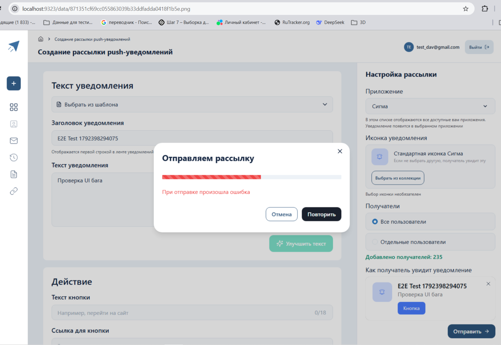

# OmniNotice E2E Automation

[](https://playwright.dev)
[](https://nodejs.org)
[](#)

Демонстрационный репозиторий сквозных (E2E) тестов для платформы **OmniNotice**. 
Проект включает в себя UI-тесты «глазами пользователя» и быстрые API-тесты.

## 🎥 Демонстрация (Найденный баг в UI)

На скриншоте ниже видно, как автоматизация доходит до конца формы, нажимает «Отправить», но получает ошибку от бэкенда.



👉 **[Скачать видео работы теста (docs/demo.webm)](docs/demo.webm)** *(нажмите на ссылку, чтобы посмотреть процесс в деталях)*


## 🐛 Найденные баги (UI)

1. **Отсутствие `event_id` при отправке Push-рассылки.**
   - **Симптом:** При нажатии «Отправить» появляется ошибка «При отправке произошла ошибка».
   - **Причина:** Запрос `POST /api/v1/dispatches` возвращает `422 (missing event_id)`.
   - **Статус:** Зафиксирован в E2E-тесте (`tests/ui/happy-path.spec.ts`). Тест пройдет (зеленый), подтверждая наличие бага. Упадет, когда фронт будет исправлен.

## 📊 Текущее покрытие

| Уровень | Что проверяем | Статус |
|---------|---------------|--------|
| **UI (E2E)** | Воспроизведение бага 422 (missing event_id) | ✅ Passed |
| **API (Контракт)** | Валидация, Авторизация, Идемпотентность, Лимиты | ✅ 10 Passed |

## 🚀 Как запустить локально

### 1. Установка
```bash
npm install
npx playwright install chromium
2. Настройка
Скопируйте шаблон и заполните данные:

bash
cp .env.example .env.dev
В .env.dev укажите ваш DELEGATED_TOKEN (для API) и логин/пароль (для UI).

3. Запуск тестов
bash
# Запустить UI-тест (воспроизведение бага)
npm run test:ui

# Запустить все тесты (UI + API)
npm test
4. Просмотр отчета
В отчете доступны видеозаписи каждого шага и полные логи сетевых запросов:

bash
npm run test:report
🏗 Архитектура
tests/ui/ — Сценарии взаимодействия с интерфейсом.

auth.setup.ts — глобальная авторизация (StorageState).

happy-path.spec.ts — тест, документирующий баг с event_id.

tests/api/ — Проверка контрактов REST API (Playwright Request).

playwright.config.ts — Конфигурация с поддержкой записи видео и скриншотов.

📞 Контакты
QA Automation: Евгений